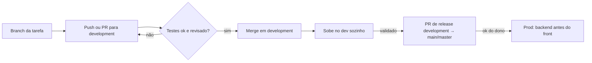

# Processo de deploy — economizai

Back e front seguem o mesmo processo: tudo entra em `development`, que sobe sozinho no dev, e prod recebe um merge de `development`. Não há staging.

| Branch | Backend | Front |
| --- | --- | --- |
| `development` | API dev | web dev |
| `main` (no front: `master`) | API prod | web prod + atualização OTA nos celulares |

## Passo a passo

1. Trabalhe em `development` (ou numa branch com PR para `development`). Rode os testes antes do push.
2. O push/merge sobe no dev sozinho. Valide lá.
3. Release: PR `development` → `main` (front: `master`), mergeado com o ok do Alexandre. Nada de cherry-pick nem commit direto em `main`/`master`.
4. Se o front depende de mudança no backend, o backend vai pra prod antes.

## Regras

- `git pull --rebase` antes de todo push.
- Cada um usa a própria conta GitHub e identidade git. Nada pessoal no `CLAUDE.md`: isso vai no `CLAUDE.local.md`, fora do git.
- Mudou algo nativo (lib, permissão, ícone)? Precisa de build de loja — ver `RELEASE.md` do front.
